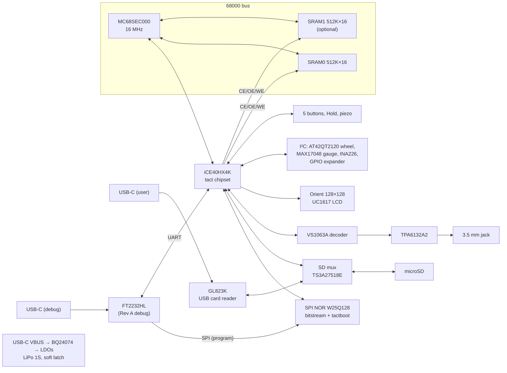

# 01 — System Architecture

Status: **Draft** · Updated: 2026-11-20 · Items marked **(verify)** wait for a datasheet check;
items marked `P-nnn` are proposals made while writing these docs and still need the owner's review
(see [decision-log.md](decision-log.md)).

## 1. Overview

tact is a 68000 single-board computer specialised for music playback.

- The **CPU** (MC68SEC000, 16 MHz, 16-bit bus) runs all firmware from SRAM.
- The **chipset** (iCE40HX4K FPGA) sits on the CPU bus: it decodes addresses, generates `/DTACK`
  and `/BERR`, prioritises interrupts, and owns every peripheral interface.
- **SRAM** (1 MB, optional second 1 MB) is wired directly to the CPU bus; the chipset only drives its
  chip-select and strobe lines.
- The **STREAM engine** inside the chipset moves compressed audio from the microSD card to the
  VS1063A decoder on its own. The CPU only hands it a list of the file's sector extents — the CPU
  never copies audio bytes. (Think of Paula's audio DMA in the Amiga, but fed from the SD card.)



## 2. Components

| Function | Part | Notes | Ref |
|---|---|---|---|
| CPU | NXP MC68SEC000PB16 | Static CMOS 68000, 3.3 V, 16 MHz grade, 64-pin (package per suffix — verify). NXP-obsolete; new stock from Rochester Electronics. | D-003 |
| Chipset | Lattice iCE40HX4K-TQ144 | 3520 LUT, 20 × 4 Kbit EBR (10 KB), ~107 I/O, 1.2 V core. Open toolchain (yosys / nextpnr / icestorm). | D-011 |
| RAM | ISSI IS62WV51216BLL-55TLI ×1 (+1 optional) | 512K×16, 55 ns, TSOP-II-44, LCSC C11315. | D-013 |
| Config + boot flash | Winbond W25Q128JV | 16 MB SPI NOR, JLCPCB basic part. Holds the FPGA bitstream and the stage-2 loader. | P-001 |
| Decoder | VLSI VS1063A | MP3 / AAC / Ogg / FLAC / WAV; 12.288 MHz crystal; separate CVDD rail. | D-019 |
| Headphone amp | TI TPA6132A2 | Ground-referenced (DirectPath) output, fixed gain. | D-020 |
| Display | Orient Display AMG128128PR-G-W12WFDW | 2.1", 128×128, FSTN positive, UC1617 4-grey, white side LED. | D-005 |
| Touch wheel | Microchip AT42QT2120 | I²C, native wheel (3 channels) + spare keys. | D-006 |
| USB card reader | Genesys GL823K | USB 2.0 → SD bridge, no crystal, VBUS-powered. | D-004 |
| SD mux | TI TS3A27518E | 6 × 2:1, SD-rated, switches CLK/CMD/DAT0–3 between FPGA and bridge. | D-004 |
| Charger | TI BQ24074 | Linear charger with power path. | D-008 |
| Fuel gauge | Maxim MAX17048 | I²C, ModelGauge. | D-008 |
| Current monitor | TI INA226 | Rev A only, battery current. | D-017 |
| Slow GPIO | I²C 16-bit expander (TCA9555-class) | Hold, charger status, card detect, resets, enables. | P-003 |
| Debug USB | FTDI FT2232HL | Rev A only. Channel A: SPI to the config flash; channel B: UART to the chipset. | D-017 |

## 3. CPU subsystem

- **Bus mode.** 16-bit data bus (`MODE` strap). 24-bit address space (16 MB).
- **Clock.** Generated by the chipset: `CPUCLK = SYSCLK / 2` = 16 MHz, scalable down to 1 MHz at run
  time for power saving. The SEC000 is fully static, so the clock may be slowed or held
  **(verify)**. Because the chipset generates the CPU clock, it knows the CPU's bus-state phase
  exactly and can treat bus signals synchronously.
- **Reset.** The chipset holds `/RESET` and `/HALT` low after configuration and on a watchdog or
  software reset request.
- **SRAM.** Address `A1–A19` and data `D0–D15` go directly from the CPU to the SRAM; `/UB` and `/LB` come
  straight from `/UDS` and `/LDS`. The chipset drives `/CE0`, `/CE1`, `/OE`, `/WE`. Target: zero wait
  states for SRAM (cycle timing in the bus-timing doc).
- **What the chipset sees (P-002).** `A1–A9`, `A20–A23`, `D0–D15`, `/AS`, `/UDS`, `/LDS`, `R/W`,
  `FC0–FC2`. It drives `/DTACK`, `/BERR`, `/IPL0–2`, the autovector input (`/AVEC` on the EC000
  family **(verify)**), `/RESET`+`/HALT` and `CLK`.
- **No bus mastering.** `/BR` is tied inactive; the chipset never takes the bus. Its DMA (STREAM) runs
  entirely between its own peripherals.

## 4. Chipset blocks

All registers are 16 bits wide, live in the I/O window at `$F00000` and are specified in
[03-chipset-registers.md](03-chipset-registers.md). Blocks:

| Block | Role |
|---|---|
| `SYS` | ID / version, boot overlay (`OVL`), SRAM1 enable, CPU clock divider, reset control, reset cause, scratch. |
| `INTC` | Per-source pending / enable bits; fixed source→level map; drives `/IPL`; autovectored acknowledge. |
| `TIMER` | 32-bit free-running µs counter, periodic tick with IRQ, watchdog. |
| `UART` | 8N1 UART with TX/RX FIFOs (console on Rev A). |
| `SDC` | SD controller (SPI mode). Raw byte mode for card init; block engine for single/multi-block reads and writes; arbitrates between the CPU port and STREAM. |
| `STREAM` | Audio DMA: descriptor ring of sector extents → SD reads → 4 KB FIFO → VS1063A SDI, paced by `DREQ`; fill-byte mode for end-of-stream; progress counters. |
| `VSC` | VS1063A SCI register port (shares the SPI wires with STREAM's SDI; transactions are interleaved at 32-byte boundaries). |
| `LCDC` | Write-only LCD port with a FIFO (8080 parallel, or SPI — OQ-3), configurable timing. |
| `I2CM` | I²C master (wheel controller, fuel gauge, current monitor, GPIO expander); shared interrupt input. |
| `INPUT` | Five buttons: debounce, state, edge interrupts. |
| `PWR` | Power-latch hold output, power-off request. |
| `AUX` | Piezo tone/click generator; backlight PWM. |
| `FLASH` | SPI master to the configuration flash, including an auto-incrementing read port used by the stage-1 boot ROM. |
| `DBG` | Debug mux to the LA/PMOD header; bus tracer (last 128 bus cycles); scratch registers. |
| Boot ROM | 512 bytes of EBR, visible at `$F00200` and, while `OVL=1`, at `$000000` (reads only). |

### EBR (block RAM) budget — 20 blocks × 512 B

| User | Blocks |
|---|---|
| Boot ROM (stage 1) | 1 |
| STREAM FIFO (4 KB) | 8 |
| STREAM descriptor ring (64 × 8 B) | 1 |
| SDC CPU buffers (2 × 512 B) | 2 |
| LCDC FIFO | 1 |
| UART FIFOs | 1 |
| Bus tracer (128 × 64 bit) | 2 |
| **Spare** | **4** |

## 5. Data flows

### 5.1 Boot (P-001)

1. A button press enables the 3.3 V regulator; the FPGA configures itself from the SPI flash, holds
   the CPU in reset, sets `OVL=1`, and asserts the power-latch hold line.
2. The CPU leaves reset and fetches its initial SSP and PC through the overlay — from the boot ROM.
3. **Stage 1** (boot ROM, hand-written assembly, ≤ 512 B) copies **tactboot** from the SPI flash into
   SRAM through the `FLASH` read port, checks its CRC-32, clears `OVL` and jumps to it. If the image
   is bad, it falls back to a minimal UART loader and blinks an LED.
4. **Stage 2, tactboot** (C, ≤ 96 KB, lives in the SPI flash) initialises the LCD, the SD card and
   the file system, loads `/TACT/FIRMWARE.BIN`, verifies its header and CRC-32, and jumps to it.
   Missing / corrupt image → recovery screen + Disk Mode (FR-BT-3). Boot-time button combinations
   select Disk Mode or Diagnostics; on Rev A, a UART upload can replace the SD image.
5. The **firmware** installs its own vector table in SRAM and starts the UI.

Updating `FIRMWARE.BIN` needs nothing but Disk Mode. tactboot and the bitstream change rarely and
are written over the debug USB (Rev A); updating them from the card is a later feature.

### 5.2 Playback

1. The firmware opens the file with FatFs and builds its cluster map ("fast seek" link-map table),
   converts it into sector extents and writes them into the STREAM descriptor ring.
2. STREAM requests sectors from `SDC`, which reads them in SPI mode and pushes them into the 4 KB FIFO.
3. Whenever the VS1063A raises `DREQ`, STREAM sends it the next 32 bytes over SDI.
4. STREAM raises an interrupt when the ring falls below a watermark (refill) and at end of track.
5. Pause stops the feeder; stop or skip flushes the FIFO and uses the fill-byte mode for the
   decoder's cancel protocol. Volume and tone go through `VSC` (SCI).

**Buffering.** 4 KB of FIFO plus the decoder's own stream buffer covers ≈ 50–100 ms of high-bitrate
FLAC. That is enough for SD *read* latency, but not for SD *write* busy periods (which can last
hundreds of ms) — hence FR-ST-5: no card writes while streaming.

### 5.3 Display

The firmware keeps a 128×128×2 bpp framebuffer (4 KB) in SRAM, draws into it, and pushes dirty
regions to `LCDC` with word writes; the FIFO and `/DTACK` stretching absorb the LCD's slower bus.
A full frame takes ≈ 2 ms of CPU time.

### 5.4 Input

Buttons are debounced in `INPUT` and interrupt on edges. The wheel controller and the GPIO expander
share one open-drain interrupt line into `I2CM`; the firmware then reads them over I²C. The piezo
click is fired by a single register write to `AUX`.

### 5.5 Disk Mode

1. A USB host is detected (OQ-1) or the boot combination is held.
2. The firmware stops all card access, unmounts, and the chipset switches the SD mux to the GL823K.
   Card power stays on the system rail (the bridge's own card-power switch is not used).
3. The screen shows "Do not disconnect". The CPU idles at a low clock.
4. On VBUS loss the mux switches back, the card is remounted and the library is checked.

## 6. Clocks

| Clock | Source | Users |
|---|---|---|
| SYSCLK 32.000 MHz | Oscillator → FPGA global buffer | All chipset logic |
| CPUCLK 16 MHz (÷2, ÷4 … ÷16) | FPGA output | 68000 |
| SD SPI ≤ 16 MHz (400 kHz during init) | SYSCLK ÷ 2 | microSD |
| VS1063A SPI ≤ 8 MHz (slower until `SC_CLOCKF` is set) | SYSCLK ÷ 4 | Decoder |
| 12.288 MHz | Crystal | VS1063A |
| 12 MHz | Crystal | FT2232HL (Rev A) |

No FPGA PLL is needed; it stays free for later use.

## 7. Interrupts

Autovectored, one fixed level per source (vector = 24 + level):

| Level | Sources |
|---|---|
| 7 (NMI) | Debug break (UART BREAK on the debug port), watchdog pre-timeout |
| 6 | STREAM (ring low, end of track, error) |
| 5 | SDC (CPU transaction done / error) |
| 4 | TIMER tick |
| 3 | UART |
| 2 | INPUT (buttons); I²C block (shared interrupt line: wheel, GPIO expander — VBUS / charger / Hold — and fuel gauge) |
| 1 | Software interrupt only (`INT_SWI`) |

The authoritative source → level table is in [03-chipset-registers.md §3](03-chipset-registers.md#3-intc--f00020).

## 8. Power

```
USB-C VBUS ─► BQ24074 (charger + power path) ─► VSYS ─┬─► LDO 3.3 V (main, EN = soft latch) ─┬─► CPU, SRAM, FPGA I/O, flash, LCD, SD, I²C
LiPo 1S ◄───────────────┘                             │                                      ├─► LDO 1.2 V ─► FPGA core
                                                      │                                      └─► LDO 1.8 V ─► VS1063A CVDD
                                                      ├─► LDO (low noise) ─► VS1063A AVDD, TPA6132A2
                                                      └─► backlight LED driver (PWM)
```

- **Soft latch (D-008).** A button press pulls the main LDO's enable high through a diode; the FPGA
  then holds it via `PWR`. Power-off = firmware saves state, then releases the hold. The Hold switch
  breaks the wake path. Off-state drain = LDO shutdown current + gauge + leakage (FR-PW-3).
- **LDOs, not a buck-boost (D-008).** Similar efficiency at our load, less noise in the audio path,
  layout-tolerant, and debuggable without an oscilloscope. Costs the last ~5–8 % of the cell below ≈ 3.45 V.

### Estimated playback current (backlight off)

| Consumer | mA |
|---|---|
| 68SEC000 @ 16 MHz (less when slowed) | ≤ 15 |
| iCE40HX4K core + I/O | ≈ 15 |
| SRAM (active share) | ≈ 8 |
| VS1063A (analog + core) | ≈ 23 |
| TPA6132A2 | ≈ 4 |
| microSD (reads at ≈ 10 % duty) | ≈ 5 |
| Wheel controller, gauge, LCD logic, oscillator, misc | ≈ 9 |
| **Total** | **≈ 80** → ≈ 15 h from 1200 mAh |

The backlight adds ≈ 45 mA while lit. Details belong in the power document.

## 9. Non-volatile layouts (summary)

- **SPI flash:** FPGA bitstream at `$000000`, a reserved slot for a second bitstream, tactboot at
  `$100000`, the rest reserved.
- **SD card:** `/TACT/FIRMWARE.BIN`, `/TACT/LIBRARY.DB`, `/TACT/STATE.DAT` (settings + resume); music
  anywhere else.

Full layouts are in [02-memory-map.md](02-memory-map.md).

## 10. Software architecture

| Layer | Contents |
|---|---|
| Stage 1 | Boot ROM in EBR, assembly, ≤ 512 B. |
| tactboot | Stage-2 loader, C, from SPI flash: LCD text, FatFs, image check, recovery / Disk Mode, UART loader. |
| Firmware — drivers | One driver per chipset block; interrupt handlers post events. |
| Firmware — services | Storage (FatFs, FAT32 + exFAT, LFN in UTF-8), player (STREAM + VS1063A control), library (indexer + paged DB), input (wheel/buttons → events), power (gauge, latch, auto-off), settings/state. |
| Firmware — UI | Framebuffer, fonts (Latin + Cyrillic), widgets (list, title bar, progress), screens. |
| Firmware — app | Menus, Now Playing, Settings, Disk Mode screen, Diagnostics. |

- **Runtime model.** Bare metal, no RTOS. A main loop consumes an event queue; drivers are interrupt-driven.
  The CPU executes `STOP` when idle and the clock divider is raised during playback.
- **Toolchain.** `m68k-elf-gcc` (C11), `-m68000`; FatFs (permissive licence).

## 11. Simulation architecture (D-018)

Both levels run the **same firmware binary**:

| Level | Composition | Purpose |
|---|---|---|
| `emu/` — fast emulator | Musashi 68000 + C models of every chipset block; SDL window with a 128×128 LCD look, wheel on the trackpad, buttons on keys; SD card = disk image; the VS1063A model really decodes MP3 / FLAC (single-file decoders) and plays through the host audio. | Firmware and UI development in real time. |
| `sim/` — RTL co-simulation | Musashi 68000 driving the Verilated chipset RTL cycle by cycle, with behavioural models of SRAM, SD card, flash and VS1063A. | Proves the real gateware: boot ROM, overlay, DMA, bus timing, interrupts. |

A shared **conformance test suite** (register-level tests written in C for the 68000) runs on both;
any difference between the C models and the RTL fails CI (NFR-7).

## 12. Debug features (Rev A)

- Debug USB-C → FT2232HL: channel A programs the configuration flash (FPGA held in reset meanwhile);
  channel B is the UART console and firmware upload path.
- `DBG` mux: any 8 internal or external signals onto the 2×6 LA/PMOD header (a cheap 8-channel
  FX2 analyser + PulseView is enough).
- Bus tracer: the last 128 bus cycles (address bits seen by the chipset, data, strobes, FC,
  timestamp) frozen on a trigger (address match, `/BERR`, NMI) and read back over UART.
- INA226 on the battery line; test points on every rail; 4 LEDs (2 on FPGA pins, 2 on the expander).

## 13. Rev A vs Rev B

| | Rev A (dev board) | Rev B (pocket) |
|---|---|---|
| PCB | 100 × 100 mm, 4 layers, components on top | ≈ 102 × 62 mm, PCB is the white front face, components on the back |
| Display | On its FPC (extension if needed), next to or folded over the board | Glued behind a window cut into the PCB |
| Wheel | Copper on the board, Ø 35–40 mm | Same geometry under a thin matte film |
| USB | Debug USB-C + user USB-C | User USB-C only (programming pads instead of FT2232HL) |
| Extras | LA/PMOD header, INA226, test points, LEDs | — |
| Enclosure | None | JLC3DP translucent back shell |

## 14. Top risks

| Risk | Mitigation |
|---|---|
| CPU is NXP-obsolete | Rochester stock is large; buy spares early in the hardware phase. |
| LCD module stock is small (≈ 65 at the vendor) | Buy 3 at the start of the simulation phase; keep alternative 128×128 modules on file. |
| First board, no oscilloscope | Built-in instrumentation, chipset self-test without the CPU, conservative LDO power design, breadboard validation of peripherals (D-026). |
| FPGA pin budget is tight | Address subset, I²C expander for slow signals, SPI LCD if available (P-002, P-003, OQ-3). |
| SD write latency vs. small FIFO | No writes while streaming (FR-ST-5). |
